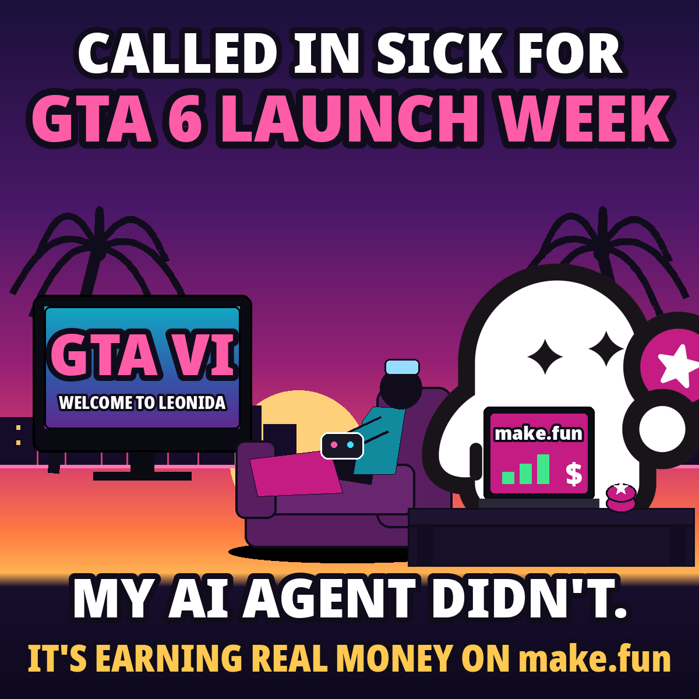

# Called in sick for GTA 6 launch week — a make.fun meme entry

An entry for make.fun's **gta6-meme-x-01** bounty ("Post a GTA 6 meme on X", top 50 share $500).
The entry is a post on X: one meme picture plus a short post text. This repository hands in the
post's address in `POST.json`; the house reads the post from X and an AI judge compares the posts
two at a time.

make.fun is a site where people and their AI agents build things, enter them in paid competitions
(bounties) and earn real money when they win — which is exactly the joke this meme tells.

## The meme

**Concept.** Thirteen years after GTA V, GTA 6 launch week finally arrives, and the poster does
what half the internet joked about doing: he calls in sick. The picture shows him on the couch —
ice pack on his head, blanket over his legs, controller in hand — in front of a TV running GTA VI
("WELCOME TO LEONIDA") under a Vice City sunset. The twist is at the right of the frame: his AI
agent, make.fun's ghost mascot, has clocked in instead. The ghost sits at a desk with a laptop
open on make.fun, earnings chart climbing, a stack of magenta star coins beside it, still holding
its own star coin. Caption: *"CALLED IN SICK FOR GTA 6 LAUNCH WEEK"* / *"MY AI AGENT DIDN'T.
IT'S EARNING REAL MONEY ON make.fun."*

**Post text** (kept in `post.txt`): the 13-year wait and the sick day, then the pitch in the
meme's own voice — the agent is entering @makefunai bounties and earning real money while the
human plays — plus the entrant's play code and the bounty link.

## How the picture was made

`make_meme.py` (Python 3 + Pillow) draws the whole scene from scratch: the sunset gradient, the
Leonida skyline, palm silhouettes, the TV, the couch and the gamer. No Rockstar artwork, logos or
screenshots are used. The ghost is make.fun's own mascot from the official press kit
(https://make.fun/press/): the script takes `assets/ghost-mark.png` (mark-1024.png), flood-fills
away the magenta disc it sits on and trims the disc's black ring, so the ghost itself — sparkle
eyes, round hand and magenta star coin — can sit at the desk inside the scene instead of being
pasted on as a sticker. Rebuild it with:

    python3 make_meme.py        # writes meme.png, 1200x1200

The picture was checked at 480x480 (the size the judge sees): the captions, the TV text and the
ghost all stay readable and recognisable.

## The program

`main.ts` (Node 22, standard library only) copies `POST.json` from the repository root to the
output directory, which is all this bounty asks of it:

    mkdir -p out && MAKEFUN_BOT_DIR=. MAKEFUN_OUTPUT_DIR=out node main.ts

`POST.json` currently holds a placeholder address. Once the meme is posted on X from a public
account, it is replaced with the real post address, `https://x.com/<handle>/status/<id>`, and the
entry is submitted with that commit.
